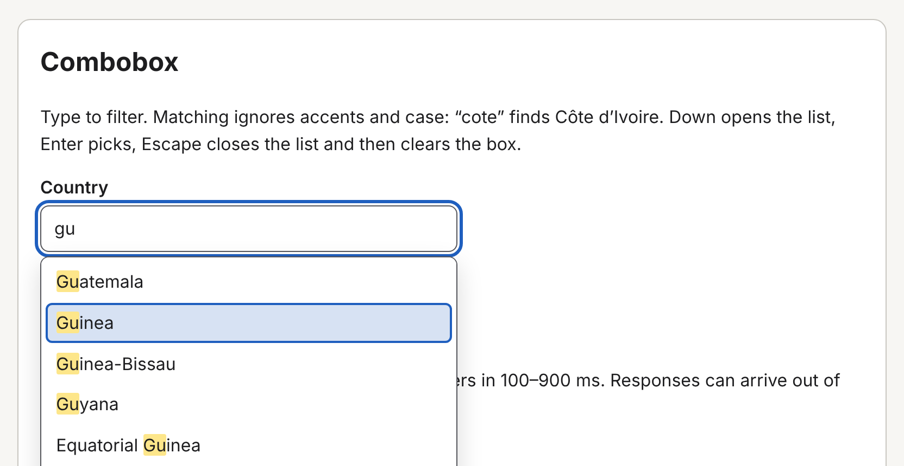
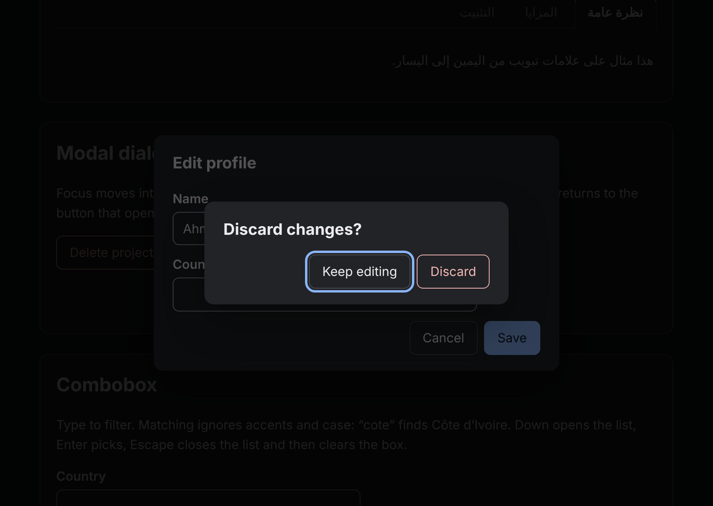
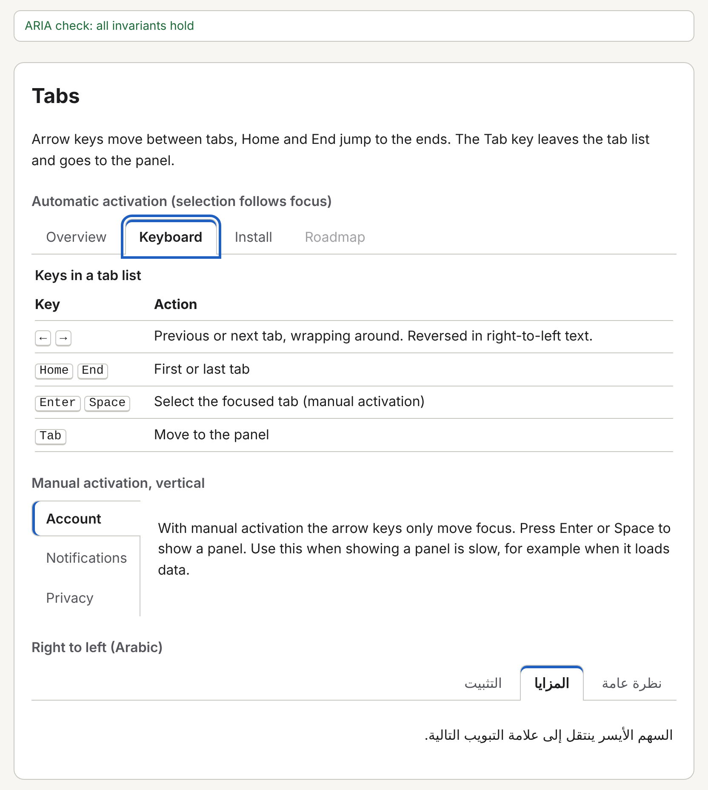

# frontend-accessible-components

[](https://github.com/AhmadElAmeer/frontend-accessible-components/actions/workflows/ci.yml)

Tabs, a modal dialog and a combobox that work with a keyboard and a screen reader, built to the [WAI-ARIA Authoring Practices](https://www.w3.org/WAI/ARIA/apg/) (APG) in plain JavaScript with no dependencies. They are tested in a real browser by driving them with the keyboard, comparing the results against small reference models, and checking the ARIA state after every key press.

**Live demo:** https://ahmadelameer.github.io/frontend-accessible-components/



## Problem

Tabs, dialogs and autocomplete fields are on almost every website, and they are among the most often broken for people who don't use a mouse:
- a "modal" that lets Tab wander into the page behind it;
- a dialog that drops focus at the top of the page when it closes;
- an autocomplete that screen readers announce as a plain text field;
- tabs that are a row of `div`s you can't reach with the keyboard.

The APG describes the expected keyboard and ARIA behaviour for each pattern, but it's a long document, and it's easy to get one rule wrong without noticing. Most component tests check a few hand-picked key presses, which is where such bugs hide.

## Overview

Three components, each starting from plain HTML that already works without JavaScript:

| Component | Starts from | Becomes |
|---|---|---|
| `Tabs` | `<section>`s with headings | a `tablist` with roving focus; automatic or manual activation, horizontal or vertical, right-to-left aware |
| `Dialog` | a `div` with `role="dialog"` | a modal: the rest of the page `inert`, a focus trap, Escape, focus returned to the opener, stackable |
| `Combobox` | a labelled `<input>` | an editable combobox with a filtered listbox: accent-insensitive matching, highlights, live result counts, and optional async search that handles out-of-order responses |

The fourth module, `checkAria(document)`, checks at run time that the page keeps the ARIA promises these patterns make, for example:
- `aria-activedescendant` points at a visible option of the right listbox;
- exactly one tab is selected, and it is the one in the Tab order;
- focus is inside the topmost open dialog, and everything else is inert.

The demo page shows its verdict live in the header. The tests call it after every simulated key press.

## Key features

- **Tabs:**
  - Arrow keys with wrap-around, skipping disabled tabs; Home/End.
  - One Tab stop for the whole list (roving `tabindex`), then the panel.
  - Manual activation (Enter/Space) for panels that are slow to show.
  - Vertical lists use Up/Down.
  - Under `dir="rtl"` Left and Right swap, so Left moves forward in Arabic or Hebrew.
- **Dialog:**
  - Initial focus on `[data-autofocus]` (e.g. "Cancel" in a destructive confirmation), else the first control.
  - Tab and Shift+Tab wrap; the page behind is `inert` and doesn't scroll.
  - Escape fires a cancelable `cancel` event first (like native `<dialog>`), so a form with unsaved changes can ask before closing.
  - Dialogs stack: the demo's "Discard changes?" opens on top of "Edit profile", and each Escape closes only the top one.
- **Combobox:**
  - Focus stays in the text box; the active option is conveyed with `aria-activedescendant`.
  - Down/Up open and move with wrap-around, and Alt+Down opens without moving. Enter and Alt+Up accept.
  - Escape closes the list, then clears the box. Home, End, Left and Right move the caret.
  - Matching ignores case, accents and apostrophe style, so "cote d'iv" finds "Côte d’Ivoire". The highlighted ranges map back to the original text, even though folding changes string lengths.
  - Ranking: prefix matches first, then word starts, then matches inside a word.
  - A polite live region announces "12 results available.", "No results." and errors.
  - Async sources are debounced (200 ms). Each new query aborts the previous request, and a sequence number discards a late response even if the server ignores the abort. A response that arrives after the user has left the field doesn't reopen the list.
- **Styling:**
  - Contrast-checked colours in light and dark mode.
  - One visible focus style.
  - No animation under `prefers-reduced-motion`.
  - Selection shown by more than colour (a bar on the selected tab, an outline on the active option).
  - Forced-colours support.

## Tech stack

- HTML, CSS and JavaScript (ES modules); no framework, no build step, no runtime dependencies.
- Tests:
  - Node's built-in test runner;
  - [Playwright](https://playwright.dev/) driving Chromium;
  - [axe-core](https://github.com/dequelabs/axe-core) in CI.
- GitHub Actions; GitHub Pages for the demo.

## Architecture

```
index.html, styles.css      demo page (also the test fixture)
demo/main.js                wires the demo; exposes window.demo for the tests
demo/countries.js           199 countries and territories with ISO codes

src/
  filter.js       fold(), match(), filterItems(), segments()   pure: matching and highlight ranges
  focus.js        tabbables(), isTabbable(), ensureId()
  tabs.js         class Tabs        markup → tablist; keyboard; select()
  dialog.js       class Dialog      open()/close(), inert, focus trap, stack, scroll lock
  combobox.js     class Combobox    listbox, keyboard, async search with abort + sequence guard
  aria-check.js   checkAria()       run-time ARIA invariants
  index.js        exports + enhance() for declarative markup

tests/
  unit/filter.test.mjs             matching, including a 5,000-case property test with a brute-force oracle
  models/tabs-model.mjs            the APG tabs rules as a pure function
  models/combobox-model.mjs        the combobox rules as a pure reducer (value, caret, open, active, results, status)
  browser/tabs.test.mjs            spec cases + 450 random sequences against the model
  browser/dialog.test.mjs          focus, trap, inert, nesting, forms
  browser/combobox.test.mjs        spec cases + 400 random sequences against the model, async races
  browser/a11y.test.mjs            contrast, focus visibility, reduced motion, small screens, axe-core
scripts/
  mutants.mjs     plants 36 bugs one at a time and runs the relevant tests
  screenshots.mjs regenerates docs/*.png
```

**Model-based testing.** The browser tests don't only check scripted key sequences. For tabs and the combobox there is a small reference model: the APG keyboard rules written again as a pure function, with no DOM. The test generates random key sequences, presses each key in the real page, applies it to the model, and compares the two after every key:
- the value, the caret position, whether the list is open, which option is active, the full list of results, and the live-region text;
- `checkAria` must also report no problems.

The model shares one function with the implementation: the matcher, which has its own tests. The interaction rules are written twice, independently, so a mistake in one shows up as a disagreement.

## Installation

```bash
git clone https://github.com/AhmadElAmeer/frontend-accessible-components
cd frontend-accessible-components
python3 -m http.server 8000        # then open http://localhost:8000
```

To use the components, copy `src/` into your project; there's nothing to build.

## Usage

```html
<div data-tabs aria-label="Project">
  <section><h3>Overview</h3><p>…</p></section>
  <section><h3>Install</h3><p>…</p></section>
</div>

<button data-opens="confirm">Delete…</button>
<div role="alertdialog" data-dialog id="confirm" aria-labelledby="confirm-title">
  <h2 id="confirm-title">Delete project?</h2>
  <button data-close="cancel" data-autofocus>Cancel</button>
  <button data-close="delete">Delete</button>
</div>

<label for="country">Country</label>
<input id="country">

<script type="module">
  import { enhance, Combobox } from "./src/index.js";
  const { dialogs } = enhance();   // tabs and dialogs from the markup
  dialogs.confirm.el.addEventListener("close", (e) => console.log(e.detail.returnValue));

  new Combobox(document.getElementById("country"), {
    source: ["Israel", "Jordan", "Lebanon"],          // or async (query, { signal }) => items
    onSelect: (item) => console.log(item),
  });
</script>
```

Options:
- `new Tabs(el, { activation: "manual", orientation: "vertical", selected: 1 })`, or `data-activation`, `data-orientation` and `data-selected` attributes.
- `new Dialog(el, { closeOnBackdrop: false, fallbackFocus })`.
- `new Combobox(input, { source, getLabel, delay, onSelect })`.

## Screenshots

| Nested dialogs, dark mode | Tabs (automatic, manual vertical, right to left) |
|---|---|
|  |  |

## Testing

```bash
npm test                     # unit tests: matching and highlighting (no browser needed)
npm run test:browser         # needs Playwright with Chromium: npm install --no-save playwright && npx playwright install chromium
node scripts/mutants.mjs     # planted bugs (about 11 minutes)
```

Results from the last full run:

- **Unit (9 tests):**
  - folding with accents, decomposed characters, emoji and curly apostrophes;
  - scoring and ranking; highlight segments;
  - a property test of 5,000 random labels and queries against a brute-force oracle. A match must happen exactly when every folded query word occurs in the folded label, and the highlights must be in bounds, sorted, non-overlapping and contain every word.
- **Browser (31 tests, plus 1 axe-core test that runs in CI):**
  - **Tabs:**
    - scripted cases for each kind of tab list;
    - Tab order across the whole page (each list is one stop);
    - the no-JavaScript version, where all 10 sections are readable;
    - **5,400 random key presses** compared with the model, with `checkAria` after every key.
  - **Dialog:**
    - initial focus (`data-autofocus`, first control, or the dialog itself), return focus and Tab wrapping;
    - **300 random Tab/Shift+Tab presses** that never leave the dialog;
    - inert background, backdrop click and scroll lock;
    - nested dialogs with the unsaved-changes prompt;
    - Escape layering with a combobox inside, and Enter on an option not submitting the form;
    - an opener removed while the dialog is open.
  - **Combobox:**
    - scripted cases, highlights, mouse and blur;
    - **10,000 random key presses** compared with the model, at every step: value, caret, open, active option, all results and the live-region text;
    - async: one request per burst of typing, a slow old response never overwriting a newer one, aborts, Escape while loading, errors and recovery, and no reopening after blur even when the server ignores the abort.
  - **Accessibility:**
    - text contrast ≥ 4.5:1 (3:1 for large text) and focus-outline contrast ≥ 3:1, checked on every visible text node in light and dark mode, in three states (initial, list open, dialog open);
    - a visible focus outline of at least 2 px on every control reached with Tab;
    - no animation with reduced motion;
    - no horizontal scroll at 320 px.
- **Planted bugs:** 36 bugs planted one at a time across the components, the matcher and the CSS. **All 36 are caught.** Four got through at first, and each now has a test:
  - `data-autofocus` ignored: the demo's autofocus target also happened to be the first control;
  - no debounce: the test typed faster than any person, so every keystroke landed before a timer could fire;
  - `close()` not invalidating an in-flight search: abort happened to cover for it, so the test now uses a server that ignores abort;
  - focus left inside a hidden dialog: Chrome tidies this up on its next frame, so the test now checks in the same task as `close()`.

  A 37th planted bug targeted a check that turned out to be redundant (`close()` already covered it), so that check was removed from the code.

The suite (`npm run test:browser`) takes about 80 s on a 2-core machine.

## Technical challenges and design decisions

- **Focus stays in the combobox's text box.** With `aria-activedescendant`, the user can keep typing while arrowing through options, and the screen reader still announces the active one. The cost is that the component must keep `aria-activedescendant`, `aria-selected`, `aria-expanded` and the listbox's visibility consistent by hand, which is exactly what `checkAria` verifies.
- **`inert` instead of a hand-written focus fence.** Making every other child of `<body>` inert removes the background from the Tab order, the mouse *and* the accessibility tree in one step; the Tab handler only adds wrapping. That's why dialogs are moved to be children of `<body>`. The first version had a real bug here: a dialog opened from another dialog was itself inert, because the first dialog had made it inert. The `checkAria` check "focus is outside the open dialog" caught it on the first run.
- **Escape has one owner at a time.** An open listbox inside a dialog takes Escape first (`preventDefault`), and the dialog ignores an already-handled Escape. A dialog's own Escape fires a cancelable `cancel` event, which is how the profile form asks "Discard changes?".
- **Async search has two guards.** Aborting the previous request saves bandwidth, but it doesn't guarantee ordering, since a server or cache can ignore the signal. A per-request sequence number makes stale responses harmless. The test gives "a" a 900 ms answer and "al" a 50 ms one with abort ignored, and checks that "al" wins.
- **Highlighting the original text.** Matching runs on a folded copy ("sao tome"), but the highlights must cover "São Tomé" in the original. `fold()` records, for every folded character, which original index it came from, so ranges map back correctly even across combining marks and surrogate pairs.
- **Two independent implementations.** A model written from the same understanding as the code can share its misunderstandings. To limit that, the models are written as reducers over plain data, in a different style from the event-driven components, and kept short enough to compare line by line with the APG tables.

## Future improvements

- Grouped options and a multi-select variant (chips) for the combobox.
- `aria-live` throttling for screen readers that read every intermediate count while typing fast.
- Tests with real screen readers (NVDA and VoiceOver). The model checks the ARIA contract, not how each reader speaks it.
- Run the browser suite in Firefox and WebKit too; only Chromium is installed here.
- More APG patterns with the same treatment: menu button, disclosure, grid.

## What this project teaches

- The WAI-ARIA roles, states and properties behind three common widgets, and the keyboard conventions users expect.
- Focus management: roving tabindex, `aria-activedescendant` versus moving DOM focus, `inert`, focus traps, returning focus.
- Progressive enhancement: markup that is useful before the script runs.
- Handling async UI races with abort signals and sequence numbers.
- Model-based testing in a real browser, run-time invariant checking, and mutation testing to measure how good the tests are.

## License

MIT — see [LICENSE](LICENSE).
